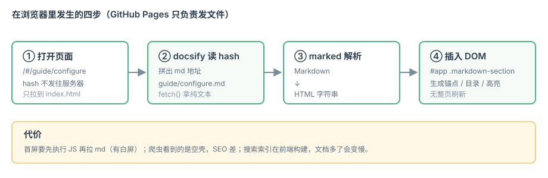

# 零构建 Markdown 文档站 · docsify Demo

这是一个可直接运行的 **docsify + GitHub Pages** 最小演示项目。
整个网站**只有 1 个 HTML 文件**（`docs/index.html`），其余全是 Markdown——没有 npm、没有构建、没有产物。

<div class="tip">

💡 **核心思路**：GitHub Pages 只当静态文件服务器，浏览器端的 docsify 负责把 `.md` 拉下来、转成 HTML。
所以 `git push` 完刷新页面就能看到更新。

</div>

## 这个 demo 演示了什么

- [x] 左侧多级目录（`_sidebar.md`）+ 顶部导航（`_navbar.md`）
- [x] 全文搜索（首次建索引，之后走 localStorage 缓存）
- [x] 代码块高亮 + 右上角「复制」按钮
- [x] 上一篇 / 下一篇自动分页
- [x] Mermaid 流程图
- [x] 图片点击放大
- [x] 日间 / 夜间模式切换（右下角 🌙 按钮，状态本地保存）
- [x] 图片相对路径的自动修正



## 目录结构

```text
docsify-demo/
├── docs/                 # ← Pages 发布的根目录
│   ├── index.html        # 唯一的"代码"，所有配置都在这里
│   ├── .nojekyll         # 关键！禁用 Jekyll，否则 _sidebar.md 会被吞掉
│   ├── _sidebar.md       # 左侧目录
│   ├── _navbar.md        # 顶部导航
│   ├── README.md         # 首页（默认渲染）
│   ├── images/
│   ├── basics/           # 基础
│   ├── guide/            # 使用
│   └── advanced/         # 进阶
└── README.md             # GitHub 仓库首页说明
```

## 本地预览

docsify 是运行时渲染，**必须通过 HTTP 访问**，直接双击 `index.html`（`file://`）会因为跨域限制拿不到 `.md`。

```bash
# 方式一：Python（零依赖，最省事）
cd docs && python3 -m http.server 3000

# 方式二：Node
npx serve docs -p 3000
```

然后打开 <http://localhost:3000>。

## 发布

```bash
git add .
git commit -m "docs: update"
git push
```

Pages 已配置为 `main` 分支的 `/docs` 目录，推送后约 1 分钟自动生效。

## 从哪开始读

推荐顺序：[docsify 是什么](basics/what-is-docsify.md) → [渲染原理](basics/how-it-works.md) → [Markdown 写法](guide/markdown.md) → [配置项](guide/configure.md) → [插件生态](advanced/plugins.md) → [部署与踩坑](advanced/deploy.md)。
