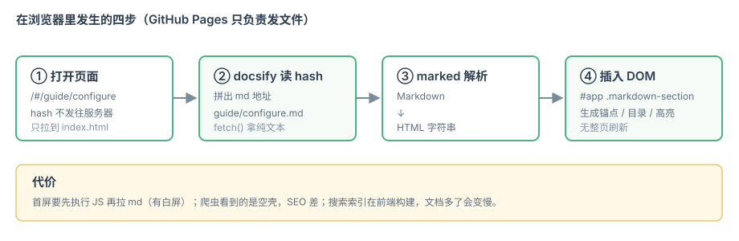

# Markdown 写法

docsify 用标准的 marked 解析 Markdown，所以**没有方言**。下面是几处和文档站特别相关的写法。

## 页面之间的链接

用相对路径写 `.md`，docsify 会在路由中正确解析：

```markdown
[上一篇](basics/how-it-works.md)
[锚点跳转](guide/configure.md?id=基础配置)
```

<div class="tip">

想链接到标题某一段，就是 `文件名.md?id=标题slug`。slug 规则：标题文字转小写、空格变 `-`、去掉标点。
例如 `## 基础配置` → `?id=基础配置`，`## What is RAG?` → `?id=what-is-rag`。

</div>

## 图片

```markdown
<!-- 根目录的 README.md 里 -->


<!-- 子目录的页面里（比如 basics/how-it-works.md） -->

```

**规则：图片路径相对于“当前 md 文件所在目录”**（跟你在 GitHub 上预览 md 时的行为一致）。
所以把图片集中在 `docs/images/` 时，子目录下的页面必须写 `../images/`。

不要写 `/images/flow.svg` 这种“以站点根开头”的路径：项目部署在 `用户名.github.io/仓库名/` 子路径下，`/images/...` 会跑到域名根去，直接 404。

## 代码块

带语言标识即可高亮，右上角会自动出现「复制」按钮：

```python
def retrieve(query: str, top_k: int = 3) -> list[str]:
    """最简检索：向量化 query，从库里取 top_k 个片段。"""
    vector = embed(query)
    return vector_db.search(vector, top_k=top_k)
```

不带语言标识的（比如目录树、纯文本）不会高亮，也更清晰：

```text
docs/
├── index.html
└── README.md
```

## 表格

| 参数 | 类型 | 说明 |
| --- | --- | --- |
| `loadSidebar` | boolean | 是否加载 `_sidebar.md` |
| `subMaxLevel` | number | 侧边栏自动展开到几级标题 |
| `auto2top` | boolean | 切页是否回到顶部 |

## 提示块

docsify 没有内置 callout，用 HTML 就能实现（样式在 `index.html` 的 `<style>` 里）：

```html
<div class="tip">💡 这是一条提示</div>
```

效果就是页面上这种绿色左边框的块。

## 任务列表

- [x] 已完成
- [ ] 待办

## Mermaid 流程图

用 `mermaid` 作为代码块语言：


## Emoji 与脚注

Emoji 可以直接用 Unicode 字符：🚀 ✅ ⚠️ 📖

脚注 docsify 原生不支持，需要自己写插件把 `[^1]` 转成 HTML——[all-in-rag](https://github.com/datawhalechina/all-in-rag) 的 `index.html` 里就有一段 `hook.beforeEach` 干这个。
